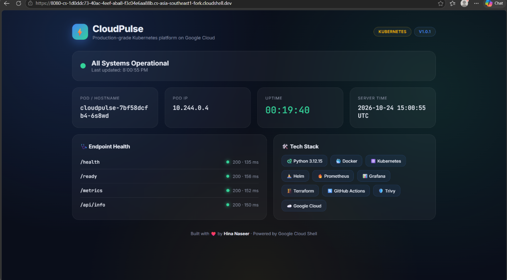
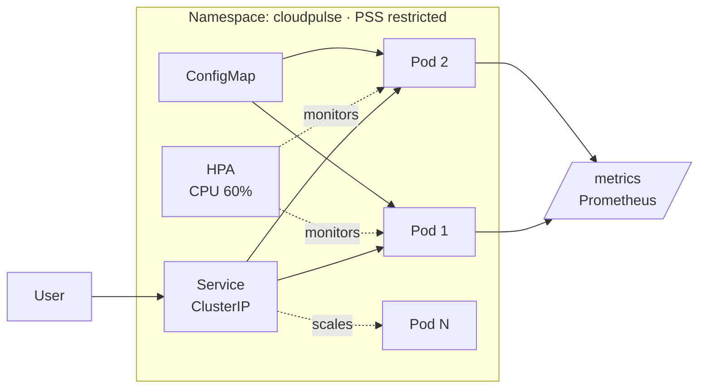

# ⚡ CloudPulse

**Production-grade Kubernetes platform with a full DevOps lifecycle, built entirely in Google Cloud Shell.**




---

## 🎯 What this project demonstrates

| Area | Implementation |
|---|---|
| **Application** | Flask app with liveness/readiness endpoints and Prometheus metrics |
| **Containerization** | Multi-stage build, non-root user (UID 10001), HEALTHCHECK, Gunicorn |
| **Security** | Trivy scan (0 misconfigurations), Pod Security Standard `restricted`, read-only root FS, all capabilities dropped |
| **Kubernetes** | Deployment, Service, ConfigMap, HPA, startup/liveness/readiness probes, resource limits |
| **Reliability** | Zero-downtime rolling updates, autoscaling 2→6 pods, scale-down stabilization |
| **Observability** | Prometheus metrics with low-cardinality labels, scrape annotations |

## 🏗️ Architecture



## 📁 Project structure

```
cloudpulse/
├── app/
│   ├── app.py               # Flask app with health, readiness and metrics endpoints
│   ├── templates/index.html # Live dashboard UI
│   ├── requirements.txt     # Pinned dependencies
│   └── Dockerfile           # Secure multi-stage build
└── k8s/
    ├── namespace.yaml       # Namespace with Pod Security Standards
    ├── configmap.yaml       # App configuration
    ├── deployment.yaml      # Hardened deployment with probes and limits
    ├── service.yaml         # ClusterIP service
    └── hpa.yaml             # Horizontal Pod Autoscaler
```

## 🚀 Quick start

```bash
# Build the image
cd app && docker build -t cloudpulse:v1.0.1 .

# Start Minikube and load the image
minikube start --driver=docker
minikube addons enable metrics-server
minikube image load cloudpulse:v1.0.1

# Deploy everything
kubectl apply -f k8s/namespace.yaml
kubectl apply -f k8s/

# Open the dashboard
kubectl port-forward -n cloudpulse svc/cloudpulse 8080:80
```

## 📈 Autoscaling demo

Under load, the HPA scaled the deployment from **2 → 4 pods** in under a minute, then scaled back to **2 pods** after the 120-second stabilization window once traffic stopped.

```bash
# Generate load
kubectl run load-test --restart=Never --image=busybox -n default -- \
  sh -c 'while true; do wget -q -O- http://cloudpulse.cloudpulse.svc.cluster.local/ > /dev/null; done'

# Watch it scale
kubectl get hpa -n cloudpulse -w
```

## 🗺️ Roadmap

- [x] Flask app with metrics and live dashboard
- [x] Secure Docker image + Trivy scanning
- [x] Kubernetes manifests with HPA and Pod Security Standards
- [x] Helm chart
- [x] Prometheus + Grafana monitoring
- [ ] GitHub Actions CI/CD (test, build, scan, push to GHCR)
- [ ] Terraform for GKE

## 👩‍💻 Author

**Hina Naseer** · DevOps & Cloud Instructor · CKAD

[GitHub](https://github.com/hinanaseer)